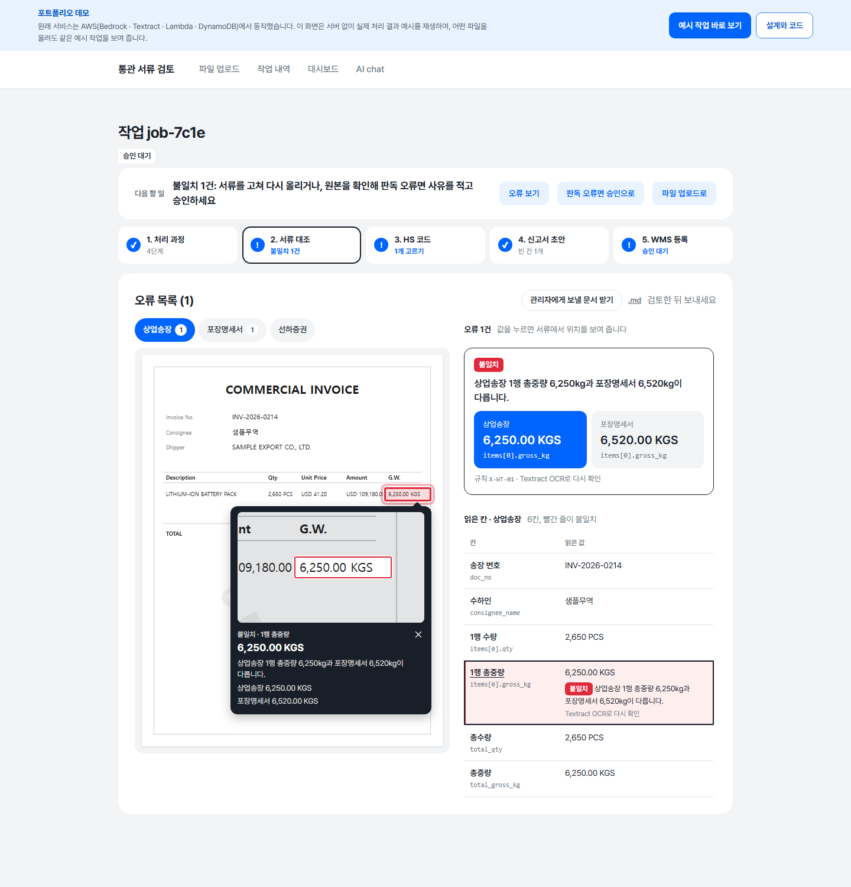
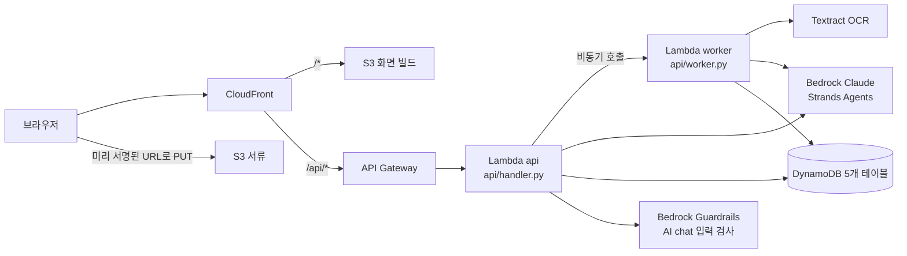
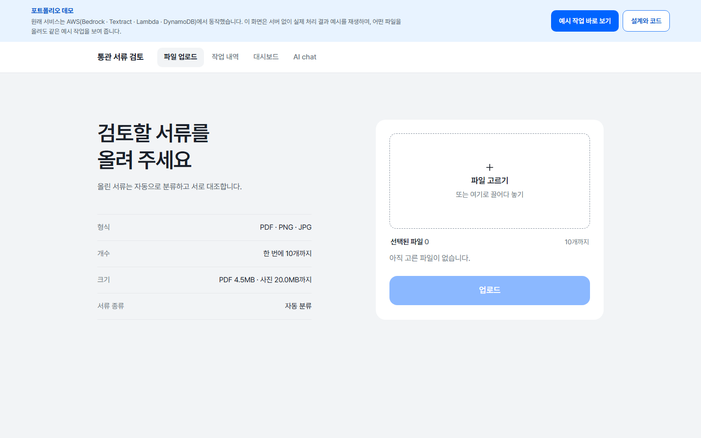
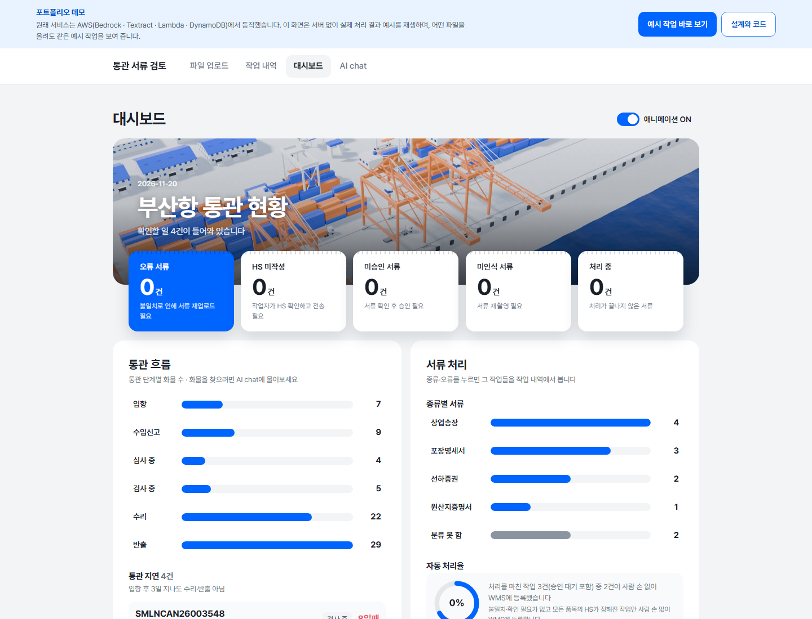
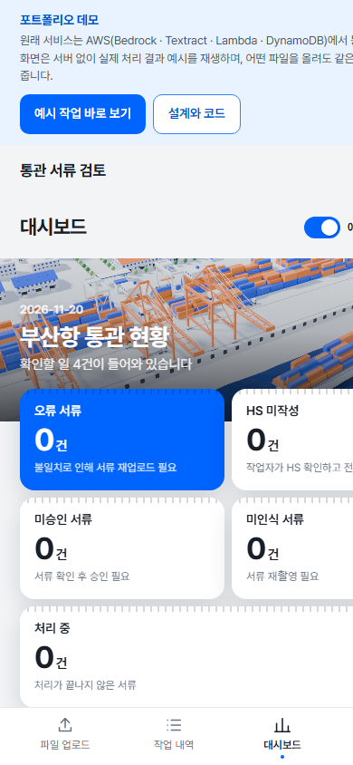

# 통관 서류 검토 Agent

**부산항 수입 서류 묶음(B/L · 상업송장 · 포장명세서 · 원산지증명서)을 입항 전에 서로 대조해, 틀린 칸을 근거와 함께 짚어 주는 AI 에이전트.**
2026 PNU X AWS AI 마에스트로 해커톤 6팀 (과제: AI 기반 첨단물류 문서 자동화 Agent, 06 SMART LOGISTICS)

| | |
| --- | --- |
| 데모 (항상 열림) | **https://gamaius.github.io/aws.ai.maestro.6/** — 서버 없이 실제 처리 결과 예시를 재생한다 |
| 발표 영상 | [team6_workflow_blender.mp4](https://github.com/GaMaius/aws.ai.maestro.6/releases/download/hackathon-2026/team6_workflow_blender.mp4) (1분 54초, 무음) |
| 대회 때 AWS 배포 코드 | 브랜치 [`archive/aws-hackathon`](https://github.com/GaMaius/aws.ai.maestro.6/tree/archive/aws-hackathon) · 릴리스 [hackathon-2026](https://github.com/GaMaius/aws.ai.maestro.6/releases/tag/hackathon-2026) |
| AWS 없이 직접 돌리기 | [local/README.md](local/README.md) (FastAPI · SQLite · Groq 무료 등급) |



## 무엇을 풀었나

수입 화물 한 건에는 서류가 네 종류 따라온다. 같은 값(총중량, 수량, 송장 번호, HS 코드 …)이 서류마다 따로 적혀 있어서, 하나라도 다르면 통관이 늦어지고 고치는 데 며칠이 걸린다.
지금은 포워더 실무자가 서류를 나란히 펴 놓고 눈으로 대조한다.

이 에이전트는 서류 묶음을 올리면

1. **분류**: 어떤 서류인지 고른다 (서류 종류를 고르지 않아도 된다)
2. **읽기**: 핵심 칸을 읽는다. 사진·스캔본도 받는다
3. **대조**: 서류끼리 값을 맞춰 보고, 다르면 **어느 서류의 어느 칸이 어떻게 다른지** 서류 그림 위에 표시한다
4. **HS 코드**: 확정 이력 → 서류 일치 → 후보 3개 순으로 고르고, 확정 못 하면 관세사에게 보낼 요청서를 만든다
5. **신고서 초안**과 **가상 WMS 등록**: 문제가 없으면 바로, 있으면 사람이 승인한 뒤
6. **AI chat**: "이번 주 통관 지연 건 알려줘"처럼 물어 현황을 본다 (조회 조건과 표를 함께 보여 준다)

설계 원칙은 **"AI는 읽기, 판정은 코드"**다. 모델은 서류를 읽고 도구를 고르기만 하고, 맞다/틀리다 판정과 신고서·문서 채우기는 규칙 코드가 한다 ([.kiro/steering/agent-design.md](.kiro/steering/agent-design.md)). 그래서 같은 입력이면 판정이 같고, 근거를 칸 단위로 보여 줄 수 있다.

## 측정 결과

개발용 합성 데이터셋 75세트(서류 288장, 오류를 심은 세트 포함)를 **실제 판독으로 끝까지, 고정 순서로 한 번** 돌린 결과다 (`eval/results/e2e_dev_summary.json`, 근거는 [docs/presentation/근거표.md](docs/presentation/근거표.md)).

| 항목 | 결과 |
| --- | --- |
| 서류 분류 | 288 / 288장 (PDF · PNG · 스캔본 모두) |
| 심은 P0 오류 찾기 | 37 / 37건 |
| P1 포함 오류 찾기 | 46 / 53건 (놓친 7건은 두 서류에 같은 틀린 HS가 적힌 경우 등) |
| 오류 없는 세트의 오탐 | 0 / 30세트 |
| 핵심 칸 읽기 (칸 채점) | 412 / 450칸. 틀린 38칸은 모두 합계 줄이 없는 송장의 총수량을 '칸 없음'으로 답한 것, **지어낸 값은 0** |
| HS 자동 확정 | 틀린 자동 확정 0건. 사람 확인 131줄 중 117줄은 정답이 후보 3개 안 |
| 처리 시간 · 비용 | 세트당 평균 18.5초 (최대 28.3초), 세트당 약 0.18달러 (어림) |

합성 데이터의 오류 비율은 탐지율을 재려고 높게 잡은 것이라 실제 빈도가 아니다. 발표용 50세트와 에이전트 루프 조건은 따로 재지 않았다.

## 구조

### 대회 때 (AWS, ap-northeast-2)



- 화면: React 19 + Vite + TypeScript, TanStack Query (2초 폴링), 해시 라우팅, 정적 빌드만 ([web/README.md](web/README.md), 디자인 명세 [web/DESIGN.md](web/DESIGN.md))
- 에이전트: Strands Agents SDK + Bedrock Claude (global 추론 프로필). 서류 분류·읽기는 구조화 출력, AI chat은 읽기 전용 도구만 고르는 Agent
- 인프라는 `infra/`의 셸 스크립트로만 만들었다 (IAM 최소 권한 정책 파일, 테이블 키 약속, 데모 초기화 스크립트)

### 지금 (개인 포크)

대회 계정은 계속 켜 둘 수 없어서 구조를 바꿨다 ([docs/REBUILD.md](docs/REBUILD.md)).

| 부분 | 어떻게 |
| --- | --- |
| 데모 사이트 | `web/`의 모드 `demo` 빌드를 GitHub Pages에 올린다. 서버 없이 `docs/examples/`의 처리 결과를 재생한다. 내려받기 문서(통지 문서 · HS 확인 요청서 · 검수 완료서)는 같은 파이썬 코드로 미리 만든다 |
| 직접 처리 | 원래 코드를 고치지 않고, boto3가 AWS 대신 로컬 대체물을 돌려주게 한다: DynamoDB → SQLite, S3 → 폴더, Lambda → 스레드, Textract → PDF 글자층/Tesseract, Bedrock → OpenAI 호환 API(Groq 무료 등급, Ollama) |

## 화면

| 업로드 | 대시보드 | 모바일 |
| --- | --- | --- |
|  |  |  |

- 모바일(주 사용) · 태블릿 · PC 세 크기에 맞춘 배치. 모바일은 아래 탭, 표는 카드로 바뀐다
- 오류를 누르면 서류 그림 위의 그 칸에 박스와 확대 창이 뜬다 (OCR 위치)
- 발표 영상의 부산항 장면은 Blender로 만들고, 화면 UI는 Remotion으로 얹었다

## 팀과 내가 맡은 것

5명이 담당을 나눠 GitHub 이슈와 PR로 일했다 ([TEAM.md](TEAM.md), [CONTRIBUTING.md](CONTRIBUTING.md)). 개발 도구로 Kiro와 Claude Code를 같이 썼고, 팀 규칙은 `.kiro/steering/`에 두어 모두의 도구가 같은 규칙을 읽게 했다.

**[@GaMaius](https://github.com/GaMaius): 3번 화면 담당.** 사용자가 보는 웹 화면 전체 (`web/`)

- 업로드 → 처리 단계 → 결과(오류 · HS 선택 · 신고서 초안 · WMS 승인) 화면, 작업 내역, 대시보드, AI chat
- 서류 그림 위 오류 위치 표시(DocViewer), 화면 크기별 배치, 접근성(누르는 곳 44px, 색만으로 상태를 구분하지 않음)
- 서버 없이 화면을 개발하는 가짜 응답 모드(`docs/examples/`의 약속 예시를 그대로 읽음)와 Vitest 시험
- 발표 영상(Blender 부산항 장면 + Remotion)
- 대회 뒤: 이 포크의 포트폴리오 데모 사이트와 AWS 없는 로컬 실행

## 직접 해 보기

```bash
# 데모 사이트를 내 PC에서
cd web && npm ci && npm run build:demo && npx vite preview --mode demo   # http://localhost:4173

# 실제 처리 (AWS 없이, Groq 무료 키 필요)
uv sync --group local
cp local/env.example .env        # GROQ_API_KEY 적기
uv run --group local uvicorn server.app:app --port 8000
cd web && npm run dev:local      # http://localhost:5173

# 시험
uv run pytest -q
cd web && npm test
```

## 폴더

| 폴더 | 내용 |
| --- | --- |
| `web/` | 화면 (React + Vite + TypeScript) |
| `agent/` | 서류 처리 Agent, 현황 조회 Agent, 모델 설정 |
| `tools/` | 분류·읽기, 대조 규칙, HS, 신고서·문서 PDF, WMS, 현황 조회 |
| `api/` | API(Lambda 진입점)와 처리 worker |
| `local/`, `server/` | AWS 없이 돌리는 대체물과 FastAPI 서버 |
| `infra/` | 대회 때 AWS 리소스 생성·배포 스크립트 (기록용) |
| `samples/`, `eval/` | 합성 데이터셋 생성기, 측정 스크립트와 결과 |
| `docs/` | 데이터 약속(schema.md), 응답 예시, 발표 자료, 재구축 계획 |

## 주의

- 서류의 회사·번호는 모두 가상이다. `samples/`에는 개발용 세트만 올렸고, 발표용 세트는 해시(`samples/test_lock.json`)로만 잠가 두었다.
- `refs/`는 출처(`refs/sources.csv`)만 올린다. 레퍼런스 원본은 저작권 때문에 올리지 않는다.
- 키·토큰·계정 번호를 어떤 파일에도 적지 않는다.

MIT License
